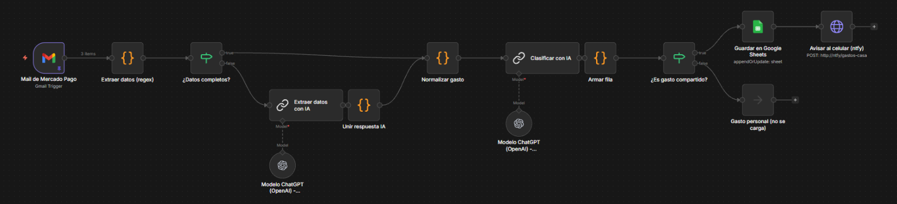
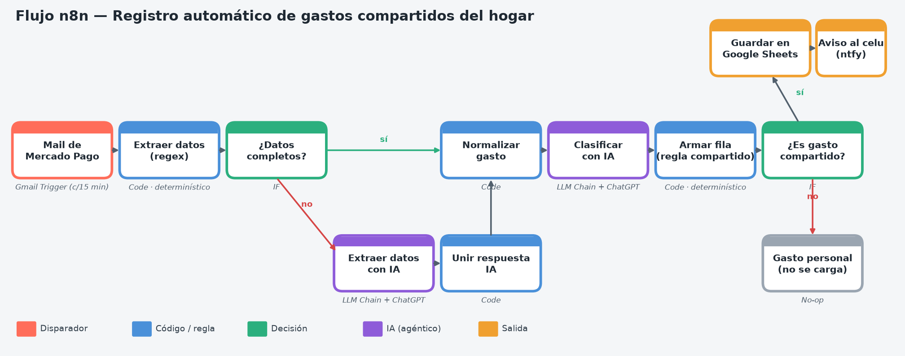

# Registro automático de gastos compartidos con n8n

Trabajo Práctico (Actividad 1: análisis de caso de automatización) para **Seminario de Actualización** del IFTS N° 11, Tecnicatura Superior en Ciencia de Datos e IA, 2° cuatrimestre 2026.

## El problema
En una casa compartida, cada pago de un gasto común hecho con Mercado Pago se pasa a mano a una planilla para dividirlo después. Es una tarea repetitiva: lleva tiempo y genera errores como montos mal tipeados, olvidos y duplicados.

## La solución
Un flujo en n8n que combina pasos **determinísticos** y **agénticos**:

1. **Mail de Mercado Pago (Gmail Trigger)**: revisa cada 15 minutos si llegaron mails de pago.
2. **Extraer datos (regex)**: saca el monto, el comercio y el número de operación con expresiones regulares.
3. **¿Datos completos?**: si la regex no alcanza, deriva el mail a la IA.
4. **Extraer datos con IA**: ChatGPT (gpt-4o-mini) lee el mail y devuelve un JSON con los datos.
5. **Normalizar gasto**: deja las dos ramas con el mismo formato.
6. **Clasificar con IA**: asigna una categoría (Supermercado, Servicios, Farmacia, etc.).
7. **Armar fila**: una regla fija decide si el gasto es compartido y calcula cuánto le toca a cada uno.
8. **Guardar en Google Sheets**: hace append/update usando el número de operación como clave, así no hay duplicados.
9. **Avisar al celular (ntfy)**: manda una notificación push con el resumen.

## Prueba (datos ficticios)

| Mail de prueba | Extracción | Categoría | Resultado |
|---|---|---|---|
| Pagaste $ 12.500,00 a SUPERMERCADO EJEMPLO | Regex | Supermercado | Compartido: $6.250 c/u |
| Se acreditó tu pago de 4.300 pesos en Farmacia Demo | IA (la regex no encontró el monto) | Farmacia | Personal: no se carga |
| Pagaste $ 9.800 a Empresa de Luz Ficticia | Regex | Servicios | Compartido: $4.900 c/u |

## Cómo importarlo
1. En n8n: **Workflows → Import from File** → `flujo_gastos_compartidos.json`.
2. Configurar las credenciales de Gmail, Google Sheets y OpenAI.
3. En el nodo "Guardar en Google Sheets", pegar la URL de una planilla con la hoja `registro_gastos` y estas columnas:
   `id_operacion, fecha, comercio, monto, categoria, compartido, monto_por_persona, metodo_extraccion, cargado_el`

> El archivo no incluye credenciales ni datos reales.
